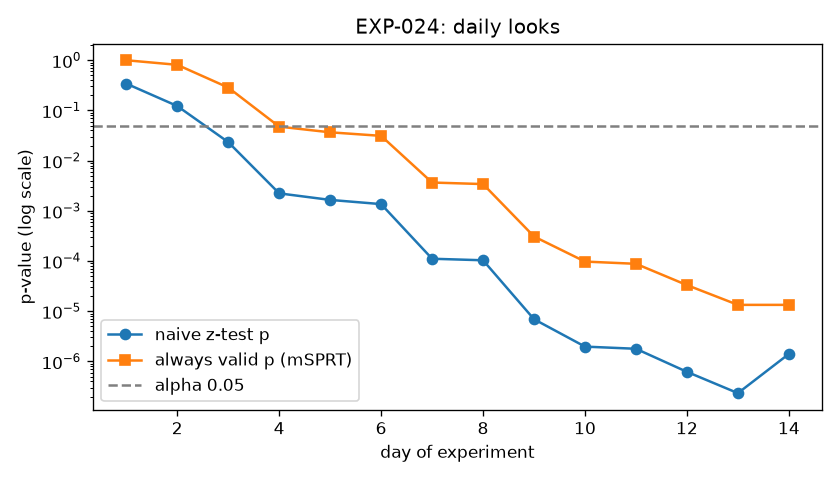
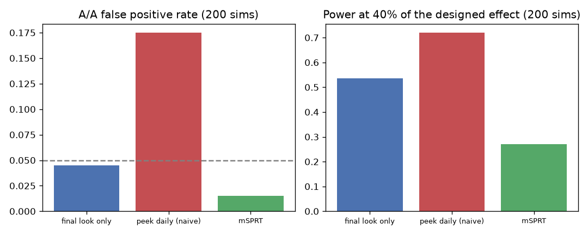

# Experiment rigour checks for EXP-024

These checks sit on top of the main readout. They were run on 24 November 2026 on a CPU only Linux machine, against the 2026-06-19 Inside Airbnb snapshot with the default seed. The experiment layer is simulated (see the README), so the numbers show the methods working, not a business result.

```bash
python -m analytics.rigour_report --sims 200 --workers 2 --out reports/rigour   # about 11 minutes
```

Outputs: [exp024_advanced_stats.json](../reports/rigour/exp024_advanced_stats.json), [monte_carlo_summary.json](../reports/rigour/monte_carlo_summary.json), [monte_carlo_runs.csv](../reports/rigour/monte_carlo_runs.csv). Code: `analytics/advanced_stats.py` and `analytics/rigour_report.py`. No database is needed.

## Power and sample size

Control conversion was 9.86% with 42,349 users per variant over 14 days. Users needed per variant for 80% power at alpha 0.05:

| Relative lift to detect | Users per variant | Days at observed traffic |
| --- | --- | --- |
| 2% | 361,917 | 119.6 |
| 5% | 58,664 | 19.4 |
| 10% | 14,977 | 5.0 |
| 15% | 6,792 | 2.2 |

At the sample actually collected, the minimum detectable effect was 0.57 percentage points (5.8% relative). A 5% lift would have needed about 19 days, not 14.

## Sample ratio mismatch

Overall: 42,349 control and 42,397 treatment, chi square p = 0.869, no mismatch. The same test on each of the 14 days, with Holm correction at alpha 0.001: no day flagged.

## Bootstrap confidence intervals (2,000 resamples per metric)

| Metric | Control | Treatment | Relative lift | 95% CI |
| --- | --- | --- | --- | --- |
| Booking conversion | 9.86% | 10.87% | +10.2% | +5.8% to +14.9% |
| Revenue per user (simulated, GBP) | 126.93 | 140.06 | +10.3% | +3.5% to +17.9% |

Revenue per user is heavy tailed, so its interval is much wider than the conversion interval.

## CUPED variance reduction

The simulator has no pre-experiment metric per user, so CUPED uses covariates known before the treatment page renders: device, traffic source and the observable attributes of the first listing viewed (rating, price against the borough median, room type, instant book, superhost). Theta is fitted on the pooled sample.

| Metric | Unadjusted estimate (SE) | CUPED estimate (SE) | Variance reduction | CI width ratio |
| --- | --- | --- | --- | --- |
| Conversion (pp) | +1.010 (0.209) | +0.999 (0.208) | 1.1% | 0.994 |
| Revenue per user (GBP) | +13.12 (4.29) | +12.64 (4.27) | 0.9% | 0.995 |

The reduction is only about 1%. These covariates explain little of who books, and there is no pre-period booking history to use. Across 200 simulated A/B runs the CUPED standard error averaged 0.00208 against 0.00209 unadjusted, which matches. CUPED pays off when a strong pre-period metric exists; here it is honest to report that it barely helps.

## Multiple testing across segments

40 segment tests (device, traffic source, room type and each borough with at least 500 users). At p < 0.05: 13 significant without correction, 3 after Holm (family wise error) and 7 after Benjamini-Hochberg (false discovery rate). Segment level wins should be read through the corrected columns in the JSON.

## Sequential testing: peeking versus an always valid test



On EXP-024 the naive daily z-test first crossed 0.05 on day 3 and the always valid mSPRT p-value (normal mixture, tau 0.01) on day 4 (days counted from 1).

To measure error rates, the whole experiment was regenerated 200 times per scenario (seeds 1000 to 1199) with the treatment effect set to 0 (A/A), to the designed effect, and to 40% of it:



| Decision rule | A/A false positive rate | Power, designed effect | Power, 40% effect |
| --- | --- | --- | --- |
| z-test once at day 14 | 4.5% (9/200) | 100.0% | 53.5% |
| z-test checked every day, stop at first p < 0.05 | 17.5% (35/200) | 100.0% | 72.0% |
| mSPRT, checked every day | 1.5% (3/200) | 99.5% | 27.0% |
| CUPED z-test once at day 14 | 3.5% (7/200) | 100.0% | 54.0% |

Peeking every day with a fixed horizon test raised the false positive rate from about 5% to 17.5%. The mSPRT kept it at 1.5% while still allowing daily looks, at the cost of power when the effect is small (27% against 54%). The 200 run estimates have a margin of roughly ±3 percentage points.
